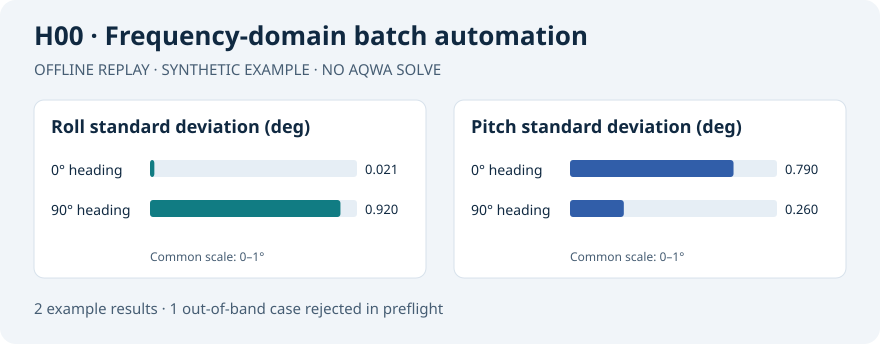

# AQWA MCP：H00 半潜式风机频域分析自动化

**AQWA H00 frequency-domain batch automation via Model Context Protocol · v0.1.0**

输入多组海况，检查水动力频带，依次调用本地 AQWA，提取六自由度运动与三根系泊缆的动态张力统计，并生成 HTML 对比报告。案例重点是把求解流程变成可复查的工具：频带不足的工况在启动前会被拦截，不自动外推。



## 快速开始：不需要 AQWA

下载并解压仓库，用 Python 3.11 或以上版本在项目根目录运行。不需要安装第三方 Python 包，也不需要联网。

```sh
python -B demo.py
python -B -m unittest discover -s tests
```

打开 `demo-output/comparison.html`。同时会生成 `comparison.json` 和 `overview.svg`。报告里可看到两组合成响应和一组频带不足对照；示例 90° 横摇标准差为 0.920°，示例 0° 纵摇标准差为 0.790°。**这些是手工设定的公开演示数值，不是 AQWA 输出，不能用于工程评价。** 频带筛查本身使用解析波谱计算。如果需要再次运行，请用 `--out` 指定新的输出目录；程序不会覆盖旧报告。

## 连接 MCP 与原生求解

MCP 通过本地标准输入/输出连接。将 [mcp.example.json](mcp.example.json) 中的两个占位路径改为你的 Python 和本仓库的实际位置，按所用 MCP 客户端的方式接入。无需许可证即可调用 `get_h00_replay_example` 读取合成示例。

原生模式需要 Windows、合法安装的 AQWA 2023 R1 和与本案例匹配的 H00 私有输入。配置 `AQWA_MCP_EXE`、`AQWA_MCP_INPUTS`，可另设 `AQWA_MCP_RUNS` 指定输出目录。仓库**不提供求解器、许可证、原始工程或原生求解文件**；只有 AQWA 许可证而没有匹配的 H00 输入，仍不能复跑本案例。详见 [原生求解配置](NATIVE.md)。

| MCP 工具 | 用途 |
| --- | --- |
| `get_h00_replay_example` | 查看不需要 AQWA 的合成示例 |
| `preview_h00_full_sea_batch` | 校验 2–4 组海况及 19 点水动力数据库频带 |
| `start_h00_full_sea_batch` | 用预检校验码逐组启动符合条件的工况 |
| `get_h00_full_sea_batch` | 查看批次与子任务进度 |
| `read_h00_full_sea_batch` | 读取汇总和报告位置 |

## 适用范围

- 仅针对 H00 半潜式风机案例：**8 m/s 平均风预载＋一阶长峰随机波频域响应**。不含脉动风、时域和其他中柱高度。
- 报告统计为响应标准差。系泊部分是导缆点动态张力的标准差，不是总张力、极值或规范验算。
- 频点和频带检查仅用于本案例的数值筛查；试算阻尼未标定。结果不构成场址验证或工程认证。
